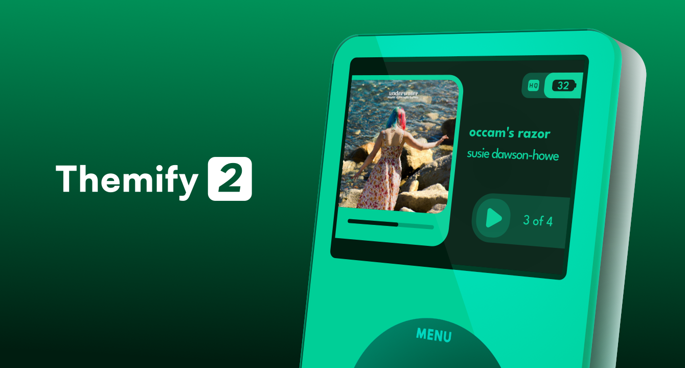

# Themify has Moved

Development for Themify 2, and all my future projects, now takes place on [sourcehut](https://sr.ht/~dook/). This repo will remain open only for submitting issues.

---

## Getting Themify 2

Main releases of Themify 2 has been moved to the [project's itch storefront](https://d00k.itch.io/themify2-and-manual). Which now includes a user manual as an extra (recommended!) download. The project will still be available from the usual rockbox channels, albeit at a delayed schedule.

---

If you want to learn more about the new update to Themify, consider checking out the [project's website](https://themify.dook.net).